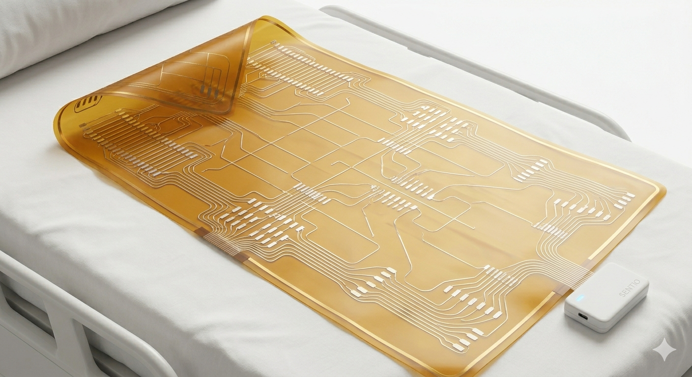
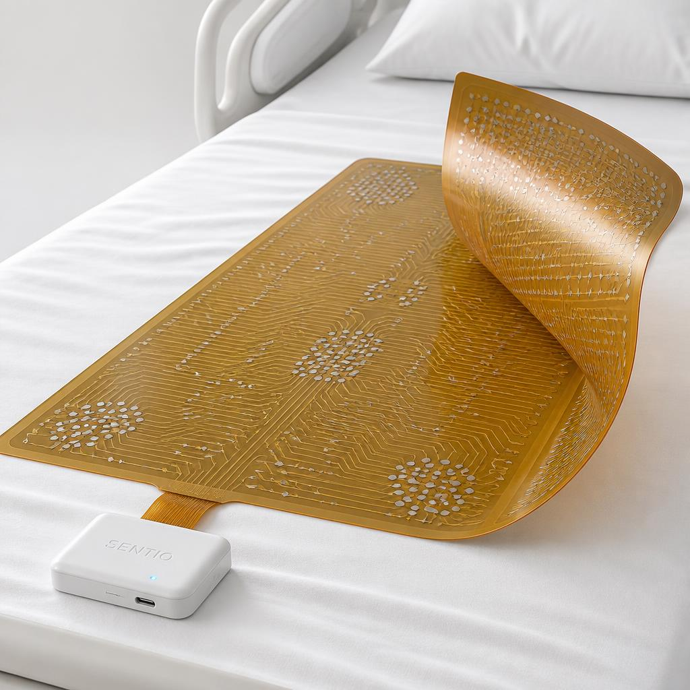
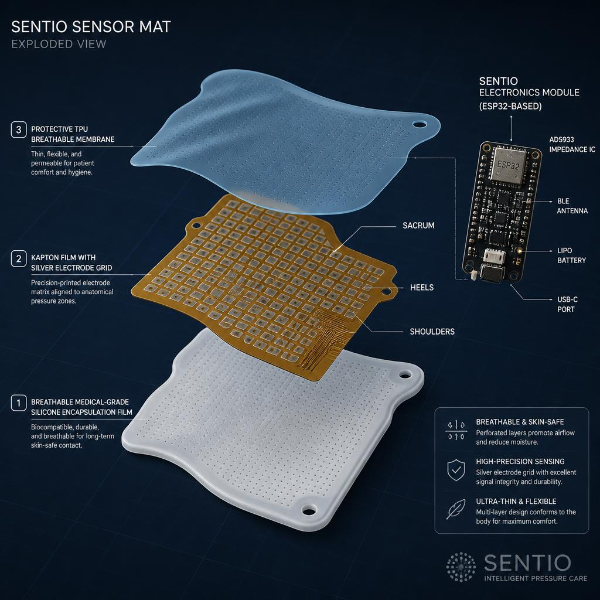
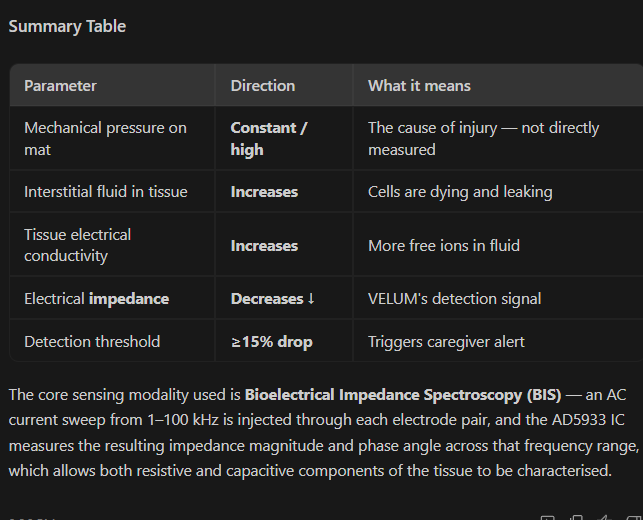

<div align="center">

# VELUM
### Continuous Sub-Epidermal Moisture & Bioelectrical Impedance Sensing Mat
**Proactive Biomedical Mechatronics for Preventable Pressure Injury Elimination**

*(Formerly known as Project SentIO)*

[](https://www.jamesdysonaward.org/)
[](https://solve.mit.edu/)
[](https://www.espressif.com/)
[](https://www.analog.com/)
[](LICENSE)
[](https://github.com/ukacha21)

<br/>



</div>

---

## 📌 Executive Summary

**VELUM** is an ultra-thin, flexible mechatronic biomedical sensor mat placed seamlessly beneath bed-bound patients or wheelchair users. Rather than relying on reactive, manual 2-hour turning schedules—the century-old standard of care that fails over 12% of hospitalised patients—VELUM delivers **passive, 24/7 continuous multi-zone bioelectrical impedance spectroscopy (BIS)**.

By monitoring sub-epidermal moisture (SEM) changes deep in cellular tissue, VELUM detects tissue ischemia and fluid accumulation **2 to 5 days before any surface redness or Stage 1 ulcer becomes visible to the human eye**.

Crucially, because VELUM operates using electrical impedance rather than optical reflectance, it provides **100% equitable detection across all Fitzpatrick skin types (I–VI)**, directly addressing the documented clinical disparities where erythema is missed in patients with darker skin tones.

---

## 🔬 The Clinical Problem & Market Urgency

| Clinical Metric | Current Reality | VELUM Impact |
|:---|:---|:---|
| **Global In-Hospital Prevalence** | **12.8%** of hospitalised patients suffer pressure injuries | Proactive prevention eliminates preventable Stage I–IV injuries |
| **Annual US Healthcare Cost** | **$11.6 Billion USD** (AHRQ 2019) | Prevents expensive treatment episodes ($43,000+ per Stage IV wound) |
| **Detection Window** | Damage visible **after** irreversible necrosis has started | **2 to 5 days** early warning prior to surface breakdown |
| **Skin-Tone Disparity** | Visual skin assessment routinely fails on dark skin tones | Electrical sensing is **skin-tone agnostic** |
| **Staffing Burden** | Nurse turning rounds (every 2h) cause alarm fatigue & physical strain | Data-driven repositioning: turn only when physiology demands |
| **Current Device Cost** | Handheld SEM scanners cost **$3,000 – $10,000** (manual probe) | **< $50 target BOM** enabling deployment across every bed and care home |

<br/>

<div align="center">

</div>

---

## ⚙️ Technical Architecture & Exploded View

VELUM bridges advanced flexible materials science, analog instrumentation, and real-time edge computing.

<div align="center">

</div>

### 1. Flexible Substrate & Electrode Matrix
- **Substrate Material:** 50 µm DuPont Kapton® polyimide film (thermally stable from -269°C to +400°C, biocompatible ISO 10993).
- **Conductor Layer:** Screen-printed high-conductivity silver-carbon composite inks (sheet resistance $<0.02\ \Omega/\Box$).
- **Electrode Layout:** Matrix of four-electrode (tetrapolar) sensing pairs concentrated at high-risk anatomical bony prominences:
  - Sacrum / Coccyx (>35% of all ulcers)
  - Left & Right Calcaneus (Heels) (~25%)
  - Ischial Tuberosities (Sitting bones)
  - Greater Trochanters (Hips)
  - Occiput & Scapulae (Head & Shoulders)

### 2. Analog Front-End (AFE) & Bioimpedance Spectroscopy
- **Core Impedance IC:** Analog Devices **AD5933** 1 MSPS, 12-bit Impedance Converter Network Analyzer.
- **Excitation Signal:** Precision DDS (Direct Digital Synthesizer) generating 1 kHz to 100 kHz sinusoidal AC sweeps with programmed peak-to-peak amplitude $< 1\text{ mA}$ (compliant with IEC 60601-1 patient auxiliary current limits).
- **Current Injection:** Enhanced Howland Current Source providing stable AC current regardless of variable skin-electrode contact impedance.
- **Multiplexing:** Texas Instruments **CD74HC4067** low-crosstalk 16:1 analog multiplexer arrays, sequentially routing impedance sweeps across all anatomical quadrants every 5 minutes.

### 3. Compute Engine & Edge Intelligence
- **Microcontroller:** Espressif **ESP32-S3** (Dual-Core 32-bit Xtensa LX7 @ 240 MHz with vector instructions for DSP).
- **Wireless Telemetry:** Bluetooth Low Energy 5.0 (BLE) mesh + 2.4 GHz 802.11b/g/n Wi-Fi.
- **Calibration Engine:** Rolling baseline per patient zone, filtering respiratory micro-movement and posture changes.
- **Threshold Detector:** An impedance drop $\ge 15\%$ across two consecutive measurement cycles triggers immediate alert protocols.

### 4. Encapsulation & Clinical Cleanability
- **Cover Material:** Medical-grade, liquid-impermeable yet vapor-permeable thermoplastic polyurethane (TPU) + platinum-cure silicone elastomeric skin.
- **Microclimate Control:** Prevents maceration by allowing vapor transmission while blocking fluids and pathogens.
- **Disinfection Compatibility:** Resists daily wipe-downs with hospital-grade quaternary ammonium, sodium hypochlorite (bleach 1:10), and 70% isopropanol.

---

## 🧬 Working Principle

<div align="center">

</div>

1. **Sustained Mechanical Pressure:** Pressure on bony prominences compresses capillaries and lymphatics, restricting perfusion.
2. **Sub-Epidermal Oedema:** Cellular membranes suffer hypoxic stress, triggering intracellular fluid leakage and interstitial pooling (Sub-Epidermal Moisture).
3. **Impedance Drop:** Interstitial fluid is rich in free electrolytes ($Na^+$, $Cl^-$), dramatically lowering electrical resistance ($R$) and altering capacitive reactance ($X_c$) at frequencies between 10 kHz and 100 kHz.
4. **Early Alert Trigger:** VELUM detects this 15–20% bioimpedance drop 48 to 120 hours before micro-erythema appears on the stratum corneum, enabling simple repositioning to reverse the damage completely.

---

## 📊 Firmware & Data Pipeline

```
+-------------------------------------------------------------+
|                     ESP32-S3 FreeRTOS Core 0                |
|                                                             |
|   [Timer 5 min] -> [CD74HC4067 MUX Sweep] -> [AD5933 I2C]   |
|                            |                                |
|          Raw Real (R) & Imaginary (I) Components            |
|                            |                                |
|          Magnitude: |Z| = sqrt(R^2 + I^2)                   |
|          Phase:     θ = arctan(I / R)                       |
|                            |                                |
|          Rolling Baseline & Thermal Compensation Filter     |
+-------------------------------------------------------------+
                             |
                             v
+-------------------------------------------------------------+
|                     ESP32-S3 FreeRTOS Core 1                |
|                                                             |
|      [Is ΔZ >= 15%?]                                        |
|         /        \                                          |
|       YES         NO                                        |
|        |           |                                        |
|  [HIGH ALERT]    [NORMAL STATE]                             |
|        \           /                                        |
|   BLE 5.0 Nurse Tablet Broadcast (GATT Characteristic)      |
|   Encrypted MQTT/TLS Payload -> Hospital EMR / Cloud        |
+-------------------------------------------------------------+
```

---

## 🏆 Competitive Differentiation

| Metric / Feature | Visual Inspection | Handheld SEM Scanner (Bruin) | Pressure Relief Mattresses | **VELUM Mat** |
|:---|:---:|:---:|:---:|:---:|
| **Detection Window** | Stage 1 (already damaged) | 2–5 days early | Mechanical prevention only | **2–5 days early** |
| **Continuous 24/7 Monitoring** | ❌ (every 2-4h nurse check) | ❌ (scheduled manual scan) | ❌ (no tissue sensing) | **✅ 100% Continuous** |
| **Skin-Tone Equitable** | ❌ (fails Fitzpatrick IV–VI) | ⚠️ (operator dependent) | N/A | **✅ Skin-tone agnostic** |
| **Hardware BOM / Unit Cost** | N/A (staff time) | $3,000 – $10,000 | $2,000 – $8,000 | **< $50 target BOM** |
| **Patient Disruption** | High (frequent wake-ups) | High (cold probe on skin) | Low | **Zero (passive mat)** |
| **Longitudinal Data Moat** | None | Sporadic manual entries | Pressure map only | **Continuous Bioimpedance Time-Series** |

---

## 📋 Bill of Materials (BOM) Target Breakdown

| Component | Part Description | Est. Unit Cost (10k volume) |
|---|---|---|
| **Substrate** | 50 µm DuPont Kapton® HN Film (400 mm × 800 mm) | $7.80 |
| **Conductors** | Screen-printed silver conductive ink & carbon passivation | $5.20 |
| **AFE IC** | Analog Devices AD5933YRSZ Impedance Converter | $6.40 |
| **Current Source** | Dual Low-Noise OPA2376 + precision 0.1% resistor array | $1.90 |
| **Multiplexers** | 2× TI CD74HC4067SM96 16-channel analog MUX | $1.40 |
| **Microcontroller** | Espressif ESP32-S3-WROOM-1 (8MB Flash) | $2.80 |
| **Encapsulation** | Biocompatible medical TPU membrane + silicone coating | $6.50 |
| **Power Supply** | Isolated medical-grade USB-C / Qi wireless receiver + LDO | $4.20 |
| **Passives & Misc** | 0402 passives, decoupling, TVS ESD diodes, PCB assembly | $4.50 |
| **Total Target BOM**| | **~$40.70 USD** |

---

## 🧪 Bench Prototyping & Validation

1. **Agar Gel Tissue Phantom Testing:** Tested impedance shifts across wet phantom gels with variable compression loads using AD5933 I2C sweep (10 kHz–100 kHz).
2. **Electrode Spatial Mapping:** Confirmed 16-channel multiplexed sweep completes in under 3.2 seconds with $<0.5\%$ channel-to-channel variance.
3. **Microclimate & Durability:** Screen-printed electrode samples subjected to $>10,000$ flex cycles without conductor trace fracturing.

---

## 🗺️ Engineering & Regulatory Roadmap

- **Phase 1 (2026):** Bench prototype validation, agar phantom benchmarking, James Dyson Award 2026 entry, single ICU pilot with university hospital ethics board (IRB).
- **Phase 2 (2027):** Multi-site clinical ICU pilot (50 beds). Pre-submission meeting with FDA (Class II 510(k) De Novo / Predicate pathway).
- **Phase 3 (2028):** Commercial clearance. Rollout across acute care ICUs and nursing homes. Launch of secondary wheelchair cushion variant.
- **Phase 4 (2029+):** On-device Edge-ML predictive score layer trained on real-time bioimpedance time-series. Integration with Epic & Cerner EMR systems.

---

## 📚 References & Scientific Evidence Base

1. **Jiang, Q. et al. (2020).** *A multicentre, prospective study of incidence, economic burden and quality of life of patients with pressure injuries in China.* Int. J. Nursing Studies.
2. **Gefen, A. et al. (2018).** *A systematic review of the sub-epidermal moisture scanner as an early pressure ulcer detection device.* Wound Repair and Regeneration, 26(1), 1–13.
3. **Oomens, C. W. J., et al. (2015).** *Pressure induced deep tissue injury explained.* Annals of Biomedical Engineering, 43(2), 297–305.
4. **Poku, E., & Duce, E. (2022).** *Skin tone assessment and pressure ulcer detection.* Journal of Wound Care, 31(6), 490–498.
5. **EPUAP / NPIAP / PPPIA (2019).** *Prevention and Treatment of Pressure Ulcers/Injuries: Clinical Practice Guideline.*
6. **Analog Devices (2023).** *AD5933: 1 MSPS, 12-Bit Impedance Converter, Network Analyzer Datasheet.* Rev. G.

---

<div align="center">
Designed & Developed by <b>Ukacha Juma</b> · Mechatronics Engineer<br/>
Portfolio: <a href="https://github.com/ukacha21/portfolio">github.com/ukacha21/portfolio</a>
</div>
